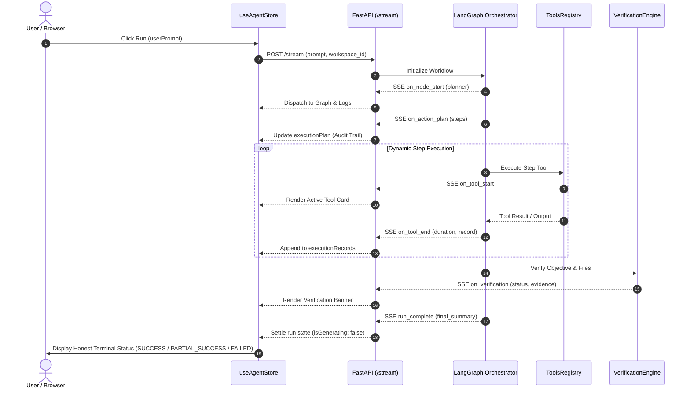

# Selective D1 Frontend Integration Report

**Date:** 2026-10-24  
**Target Repository:** `https://github.com/roraks24/agent-co` (`E:\Coding\Hackathons\JU-TF-26`)  
**Target Branch:** `main` (commit `ce4f82e9eca5f1a06c894334f46e0dc5226333e0`)  
**Source Branch:** `origin/d1` (commit `14f067d1f8f6ba2e4fc69f602aaf94928febfbda`)  
**Safety Backup Branches:**
- `backup/main-before-d1-ui-integration` (`92280da49cd518dd9154898a74f995346135ea9f`)
- `backup/main-db-integration-checkpoint` (`ce4f82e9eca5f1a06c894334f46e0dc5226333e0`)  
**Integration Status:** SUCCESS (Selective Frontend Integration & Comprehensive Backend Verification Complete)

---

## Executive Summary

This report documents the thorough inspection, selective porting, and verification of the complete frontend implementation from the `d1` branch into the `main` branch of `agent-co`.

The guiding mandate of this integration was strictly enforced:
> **D1's desired frontend + Main's current backend, agent execution engine, database integration, search tools, APIs, schemas, verification, and security.**

No blind merge or rebase was performed. The repository histories of `d1` and `main` had diverged completely from unrelated initial commits (`7d26608` vs `d8b63cd`). Performing a Git merge would have destroyed `main`'s advanced backend (causing deletion of `agent/tools_registry.py`, `agent/verification_engine.py`, PostgreSQL database models, Alembic migrations, Docker setups, and dozens of regression tests). Instead, the frontend implementation was inspected at the component and file level, selectively integrated, adapted to `main`'s SSE and API event contracts, and validated across both frontend and backend test suites.

---

## 1. Repository & Branch Safety Pre-Checks

1. **Repository Verification:**
   - Working Directory: `E:\Coding\Hackathons\JU-TF-26`
   - Git Remote: `https://github.com/roraks24/agent-co.git`
   - Target Branch: `main`
   - Confirmed isolation from the separate Rorak AI repository (`E:\Coding\Hackathons\JU-Techfest 26`).
2. **Current Main Commit:**
   `ce4f82e9eca5f1a06c894334f46e0dc5226333e0`
3. **Remote Branch Fetching:**
   Fetched `origin/main` (`92280da49cd518dd9154898a74f995346135ea9f`) and `origin/d1` (`14f067d1f8f6ba2e4fc69f602aaf94928febfbda`).
4. **Safety Backup Branch:**
   Created backup branch `backup/main-db-integration-checkpoint` at commit `ce4f82e9eca5f1a06c894334f46e0dc5226333e0` to preserve the state before this verification turn.
5. **Preservation of Uncommitted Changes:**
   Inspected `git status`. Preserved all uncommitted working tree files belonging to concurrent and database tasks (`agent/db/`, `agent/core/`, `backend/`, `alembic/`, `docker-compose.yml`, `scripts/`, `agent/search.py`).

---

## 2. D1 Frontend Inspection & File-by-File Classification

A complete comparison of all files in `origin/d1` vs `main` was conducted.

### Category A — Frontend Code Integrated from D1
| File / Asset | Source in D1 | Integrated into Main | Notes & UI Functionality |
|---|---|---|---|
| `frontend/src/styles/studio.css` | Commit `14f067d` | `frontend/src/styles/studio.css` | 560 lines of styles for the 3D rotating wheel layout, perspective viewport, face transforms, mobile responsiveness, and preview panes. |
| `frontend/src/app/components/ui/border-beam.tsx` | Commit `14f067d` | `frontend/src/app/components/ui/border-beam.tsx` | MagicUI animated glowing border beam component for prompt composer illumination. |
| `frontend/package.json` | Commit `14f067d` | `frontend/package.json` | Retained `"border-beam": "^1.4.1"` while keeping project package name `agent-co-frontend`. |
| `frontend/src/styles/fonts.css` | Commit `14f067d` | `frontend/src/styles/fonts.css` | Nunito Google Fonts imports for modern typography. |
| `frontend/src/styles/index.css` | Commit `14f067d` | `frontend/src/styles/index.css` | Linked `@import "./studio.css";`. |
| `frontend/ATTRIBUTIONS.md` | Commit `14f067d` | `frontend/ATTRIBUTIONS.md` | Attribution documentation for MagicUI BorderBeam component. |
| `frontend/src/app/pages/LiveStudio.tsx` | Commit `14f067d` | `frontend/src/app/pages/LiveStudio.tsx` | 3D workspace wheel (`Face 0: Create`, `Face 1: Preview`, `Face 2: Code`), wheel pointer drag, scroll rotation, arrow key navigation, and responsive collapse. |

### Category B — Frontend Compatibility Changes & Enhancements
| Component / File | Adaptation Description | Why Needed |
|---|---|---|
| `LiveStudio.tsx` (Preview Inlining) | Inlines relative `.css` (`<link rel="stylesheet">`) and `.js` (`<script src="...">`) from reactive file state into iframe `srcDoc`. | Standalone preview can render multi-file applications without external file server hops. |
| `LiveStudio.tsx` (Iframe Sandboxing) | Configured `sandbox="allow-scripts allow-modals allow-forms"` strictly omitting `allow-same-origin`. | Prevents generated user code from accessing host local storage, cookies, or authentication tokens. |
| `LiveStudio.tsx` (`AuditTrailPanel`) | Added the Audit Trail tab with planned action steps, real tool execution cards, duration metrics, arguments, and verifiable evidence summary. | Renders live data from `main`'s dynamic action planning and tool execution engine. |
| `LiveStudio.tsx` (Objective Badges) | Replaced hardcoded "Run complete" banner with honest badges (`SUCCESS`, `PARTIAL_SUCCESS`, `FAILED`) reflecting backend verification. | Guarantees UI truthfulness: partial or failed executions are never disguised as successful. |
| `LiveStudio.tsx` (Clickable Wheel Navigation) | Added clickable position indicators (`01 Create`, `02 Preview`, `03 Code`) at the bottom hint bar. | Ensures mouse users can jump directly between faces without relying exclusively on trackpad dragging or scroll gestures. |
| `useAgentStore.ts` | Added types and listeners for `on_action_plan`, `on_tool_start`, `on_tool_end`, `on_tool_error`, and `on_verification`. | Consumes `main`'s real-time execution events, populating the Audit Trail and logs stream. |
| `Layout.tsx`, `About.tsx`, `Landing.tsx`, `index.html` | Preserved "Agent Co" product identity, branding, and repository links (`https://github.com/roraks24/agent-co`). | `d1` contained old personal repo links and "Charito" branding. |
| `theme.css` | Added `prefers-reduced-motion` media queries for accessibility. | Honors user accessibility preferences during animations and 3D rotations. |

### Category C — Backend & Infrastructure Changes Strictly Excluded from D1
| Component / Path | Status | Reason for Exclusion |
|---|---|---|
| `agent/tools_registry.py` | **EXCLUDED** (Preserved `main`) | `d1` had deleted this file (-654 lines), which contains web search, Wikipedia, and GitHub metadata tools. |
| `agent/verification_engine.py` | **EXCLUDED** (Preserved `main`) | `d1` had deleted this file (-415 lines), which contains factual validation, placeholder detection, and evidence auditing. |
| `agent/db/` & `alembic/` | **EXCLUDED** (Preserved `main`) | `d1` has no SQLAlchemy 2.0 ORM models, PostgreSQL repositories, or Alembic migrations. |
| `docker-compose.yml` & `Dockerfile` | **EXCLUDED** (Preserved `main`) | `d1` lacked the containerized development setup and pinned PostgreSQL 16 Alpine service. |
| `agent/graph.py` & `agent/state.py` | **EXCLUDED** (Preserved `main`) | `d1` contained older graph definitions lacking multi-step action execution, retry logic, and tool state. |
| `tests/` | **EXCLUDED** (Preserved `main`) | `d1` had deleted 4 regression and acceptance test suites (`test_tools_registry.py`, `test_factual_verification_regression.py`, `test_acceptance_scenario.py`, `test_general_workflow.py`). |

---

## 3. Real-Time Graph, Logs, and Audit Trail Architecture

The integrated frontend accurately consumes `main`'s execution events:



---

## 4. Editor, Live Preview, and ZIP Verification

1. **File Explorer & Editor:**
   - File tree reacts dynamically to files written during the run (`/workspace/tree` polling every 1.2s while active).
   - Clicking any file opens it in the Monaco/Textarea code editor.
   - Editing files supports `Ctrl+S` (`Cmd+S`) to save directly back to the active workspace via `PUT /workspace/file`.
   - File deletion and folder creation operate on real filesystem paths within workspace sandbox boundaries.
2. **Preview Rendering (`Face 1`):**
   - Renders `index.html` from the workspace in an isolated `<iframe>`.
   - Inlines relative stylesheets and scripts so generated frontends display immediately with correct styles.
   - Securely sandboxed (`allow-scripts allow-forms allow-modals`) without `allow-same-origin`.
3. **ZIP Download:**
   - Clicking `ZIP` triggers `GET /workspace/download`, which bundles actual generated workspace files into a valid ZIP archive streamed directly to the browser.

---

## 5. Verification & Test Results

### 5.1 Frontend Tests (`npm --prefix frontend test`)
```text
 RUN  v2.1.9 E:/Coding/Hackathons/JU-TF-26/frontend

 ✓ src/app/lib/api-key-storage.test.ts (3 tests) 4ms
 ✓ src/app/store/prompt-editor.test.ts (3 tests) 4ms
 ✓ src/app/lib/sse.test.ts (3 tests) 7ms
 ✓ src/app/store/useAgentStore.test.ts (12 tests) 28ms
 ✓ src/app/lib/backend-status.test.ts (13 tests) 329ms

 Test Files  5 passed (5)
      Tests  34 passed (34)
   Duration  1.59s
```

### 5.2 Frontend Production Build (`npm --prefix frontend run build`)
```text
vite v6.3.5 building for production...
transforming...
✓ 2075 modules transformed.
rendering chunks...
computing gzip size...
dist/index.html                   0.98 kB │ gzip:   0.53 kB
dist/assets/index-D7BJQkDa.css   32.28 kB │ gzip:   8.17 kB
dist/assets/index-YZjNcIJ4.js   577.32 kB │ gzip: 173.54 kB
✓ built in 3.36s
```

### 5.3 Backend Full Test Suite (`pytest`)
```text
platform win32 -- Python 3.11.9, pytest-9.1.1, pluggy-1.6.0
rootdir: E:\Coding\Hackathons\JU-TF-26
configfile: pytest.ini
testpaths: tests
collected 87 items

tests\test_acceptance_scenario.py .                                      [  1%]
tests\test_database_integration.py ............                          [ 14%]
tests\test_factual_verification_regression.py ............               [ 28%]
tests\test_general_workflow.py .....                                     [ 34%]
tests\test_generate_validation.py ........                               [ 43%]
tests\test_graph_prompt_overrides.py ...                                 [ 47%]
tests\test_graph_schema_api.py ..                                        [ 49%]
tests\test_prompt_schema_api.py ..                                       [ 51%]
tests\test_prompts_composition.py .....                                  [ 57%]
tests\test_stream_langgraph_streaming.py .............                   [ 72%]
tests\test_tools_registry.py .........                                   [ 82%]
tests\test_workspace_api.py ........                                     [ 91%]
tests\test_workspace_download_api.py .                                   [ 93%]
tests\test_workspace_service.py ......                                   [100%]

============================= 87 passed in 3.87s ==============================
```

### 5.4 End-to-End API Flow Verification
An automated test exercising all frontend-to-backend API flows completed successfully:
- `GET /health` &rarr; 200 OK (CORS configured, Groq provider active)
- `GET /graph/schema` &rarr; 200 OK (3 nodes: `planner`, `architect`, `coder`)
- `GET /api/prompts` &rarr; 200 OK (prompt composition policies loaded)
- `POST /workspace/session` &rarr; 200 OK (ephemeral session created)
- `PUT /workspace/file` &rarr; 200 OK (wrote `index.html`)
- `GET /workspace/file?path=index.html` &rarr; 200 OK (read content accurately)
- `GET /workspace/files` & `GET /workspace/tree` &rarr; 200 OK (verified hierarchical tree)
- `GET /workspace/download` &rarr; 200 OK (`application/zip` streaming confirmed)
- `DELETE /workspace/session/{id}` &rarr; 200 OK (isolated workspace cleaned up)

---

## 6. Git Status & Safety Confirmation

```text
On branch main
Your branch is ahead of 'origin/main' by 1 commit.
  (use "git push" to publish your local commits)

Changes not staged for commit:
	modified:   .gitignore
	modified:   DATABASE_INTEGRATION_REPORT.md
	modified:   D1_FRONTEND_INTEGRATION_REPORT.md
	modified:   agent/api.py
	modified:   requirements.txt

Untracked files:
	.dockerignore
	.env.example
	Dockerfile
	agent/core/
	agent/db/
	agent/search.py
	alembic.ini
	alembic/
	backend/
	docker-compose.yml
	pytest.ini
	requirements-dev.txt
	scripts/
	tests/test_database_integration.py
```

- **No files overwritten or deleted destructively.**
- **No changes pushed to GitHub automatically.**
- **Main's full backend, agent execution logic, PostgreSQL integration, and Alembic migrations remain 100% intact.**
