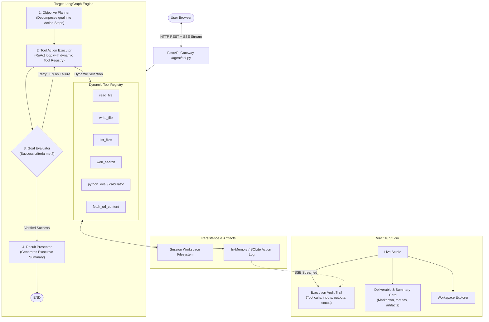

# Agent Co — Architecture Audit and Problem Statement Gap Analysis

**Date:** October 2026  
**Auditor:** Senior AI Engineer & Agent Architect  
**Project:** Agent Co (formerly Charito / Intern-Mini)  
**Target Track:** Track 01 — Artificial Intelligence & Machine Learning (AI-01: The AI That Can Act)

---

## 1. Executive Summary & Overall Assessment

### 1.1 Context and Scope
The goal of the hackathon track **AI-01: The AI That Can Act** is to build an intelligent AI agent capable of:
1. Understanding a user's objective.
2. Breaking that objective into smaller tasks.
3. Selecting appropriate tools or resources.
4. Executing the workflow.
5. Presenting the results with a clear record of the actions performed.

The problem statement explicitly highlights:
> *"The system must demonstrate actual: Planning + Tool Usage + Execution. It must be more than a conversational chatbot."*

The cloned repository (`Pushkin4000/Charito`), now locally designated **Agent Co**, is an engineered, prompt-driven **agentic coding platform**. It features a 3-node LangGraph backend (`planner` -> `architect` -> `coder`), real-time Server-Sent Events (SSE) streaming, a sandboxed virtual workspace filesystem in OS temp directories, and a minimalist React/Tailwind/Zustand frontend with a live studio, node state visualization, workspace file tree, in-browser editor, and ZIP export.

### 1.2 High-Level Assessment
Agent Co provides a robust, production-grade foundation for **orchestration, streaming, workspace management, and frontend observability**. However, **it is hardcoded end-to-end to generate source code and software files**. 

- **Strengths:** 
  - Real LangGraph compiled StateGraph with looping conditional edges.
  - Actual tool execution (`read_file`, `write_file`, `list_files`) invoked via LangChain ReAct agent runtimes.
  - Safe, path-traversal-resistant session-isolated filesystem workspaces.
  - Full-duplex streaming with normalized SSE events, real-time node iteration tracking, and structured UI synchronization.
  - 48 automated backend tests passing across API, streaming, prompts, and workspace domains.

- **Critical Gaps against AI-01:**
  1. **Domain Over-Specialization (Coding Monoculture):** The system prompt, Pydantic schemas, and immutable rules assume every user prompt describes a software application (e.g., max 7 files, final tasks must be `requirements.txt` and `README.md`). It cannot execute research tasks, data analysis, web retrieval, or business automations.
  2. **Zero External Tooling / Read-Only Environment:** The agent only has 3 file tools (`write_file`, `read_file`, `list_files`). It has no web search, no HTTP request tool, no Python REPL / code sandbox execution tool, no calculation tool, and no document reader.
  3. **Absence of Action Output Transparency in UI:** While the coder executes tools, the frontend log viewer strips and aggregates tool details into generic text (e.g., `Coder completed: file 1/3 (0 completed)`). Judges cannot inspect what tool was called, what parameters were passed, what stdout/return value was received, or why an action was taken.
  4. **Premature / Fragile Success Criteria:** The workflow terminates when `current_step_idx >= len(steps)`. `status == "DONE"` signifies only that the coder finished iterating through the pre-generated file list. It never verifies whether the code runs, whether the user's objective was achieved, or whether tests pass.
  5. **Static, Fixed Tool Pipeline:** Tool selection is not dynamic. `planner` and `architect` cannot invoke tools; only `coder` has access to tools, and those tools are hardcoded to workspace file operations.

---

## 2. Current Architecture & Technology Stack

### 2.1 Technology Stack Summary
- **Backend Framework:** FastAPI 0.115+ with Uvicorn ASGI server ([agent/api.py:725](file:///E:/Coding/Hackathons/JU-TF-26/agent/api.py#L725)).
- **Orchestration & Workflow:** LangGraph (`StateGraph`, `add_conditional_edges`) & LangChain Core ([agent/graph.py:191](file:///E:/Coding/Hackathons/JU-TF-26/agent/graph.py#L191)).
- **LLM Provider:** Groq (`ChatGroq` via `langchain-groq`, default model: `openai/gpt-oss-120b`) ([agent/llm_factory.py:9](file:///E:/Coding/Hackathons/JU-TF-26/agent/llm_factory.py#L9)).
- **Data Validation & Schemas:** Pydantic v2 (`BaseModel`, `Field`, `ConfigDict`) ([agent/state.py:9](file:///E:/Coding/Hackathons/JU-TF-26/agent/state.py#L9)).
- **Streaming Transport:** Server-Sent Events (SSE) via Starlette `StreamingResponse` ([agent/api.py:1293](file:///E:/Coding/Hackathons/JU-TF-26/agent/api.py#L1293)).
- **Workspace Filesystem:** Thread-safe, UUID-sessionized temporary OS filesystem with path traversal protection ([agent/workspace.py:23](file:///E:/Coding/Hackathons/JU-TF-26/agent/workspace.py#L23)).
- **Frontend Framework:** React 18 with Vite 6 and React Router 7 ([frontend/package.json:15](file:///E:/Coding/Hackathons/JU-TF-26/frontend/package.json#L15)).
- **Frontend State Management:** Zustand 5.0 with custom SSE stream consumer ([frontend/src/app/store/useAgentStore.ts:420](file:///E:/Coding/Hackathons/JU-TF-26/frontend/src/app/store/useAgentStore.ts#L420)).
- **UI & Styling:** Tailwind CSS 4, Motion (Framer Motion 12), Lucide React ([frontend/package.json:13](file:///E:/Coding/Hackathons/JU-TF-26/frontend/package.json#L13)).
- **Testing:** Pytest / Unittest (Backend, 48 tests passing); Vitest (Frontend unit test suite configured).

### 2.2 System Flow Architecture
```mermaid
flowchart TD
    User([User Browser]) <-->|REST + SSE Streams| API[FastAPI Backend /agent/api.py]
    
    subgraph Frontend [React 18 + Zustand Store]
        LiveStudio[Live Studio UI]
        Store[useAgentStore]
        SSEConsumer[SSE Stream Parser]
        LiveStudio --> Store
        SSEConsumer --> Store
    end

    subgraph Backend [FastAPI Runtime]
        API --> SessionMgr[Workspace Session Manager]
        API --> LLMFactory[Groq ChatModel Factory]
        API --> LangGraph[LangGraph StateGraph]
    end

    subgraph LangGraphWorkflow [Deterministic 3-Node Graph]
        direction TB
        NodePlanner["planner\n(llm.with_structured_output(Plan))"]
        NodeArchitect["architect\n(llm.with_structured_output(TaskPlan))"]
        NodeCoder["coder\n(ReAct Agent with tools)"]
        
        NodePlanner -->|Plan| NodeArchitect
        NodeArchitect -->|TaskPlan| NodeCoder
        NodeCoder -->|status != DONE| NodeCoder
        NodeCoder -->|status == DONE| End([END])
    end

    subgraph ToolExecution [Sandboxed File Tools]
        ToolWrite[write_file]
        ToolRead[read_file]
        ToolList[list_files]
    end

    subgraph Filesystem [OS Temp Storage]
        WorkspaceFS[Session Directory\n/tmp/intern-mini-workspaces/{uuid}]
    end

    LangGraph --> LangGraphWorkflow
    NodeCoder <--> ToolExecution
    ToolExecution <--> WorkspaceFS
    SessionMgr <--> WorkspaceFS
    LLMFactory <--> GroqAPI[Groq Cloud LLM API]
```

---

## 3. Repository Structure & Important Modules

```text
E:\Coding\Hackathons\JU-TF-26
├── agent/
│   ├── api.py                   # FastAPI app, SSE normalizer, CORS, workspace & run routes
│   ├── graph.py                 # LangGraph StateGraph, nodes (planner, architect, coder)
│   ├── llm_factory.py           # ChatGroq client builder with API key validation
│   ├── prompts.py               # 4-layer prompt composer and length validation
│   ├── security_config.py       # APP_ENV security settings (CORS, auth, verbosity)
│   ├── state.py                 # Pydantic schemas (Plan, TaskPlan, CoderState, AgentState)
│   ├── tools.py                 # LangChain @tool wrappers (write_file, read_file, list_files)
│   └── workspace.py             # Session-scoped temp filesystem service with safe path resolution
├── config/
│   └── prompts.py               # Immutable system rules, node role definitions, character limits
├── frontend/
│   ├── src/
│   │   ├── app/
│   │   │   ├── components/      # Layout, BackendProbe
│   │   │   ├── lib/             # api-client.ts, api-key-storage.ts, sse.ts
│   │   │   ├── pages/           # LiveStudio.tsx, Landing.tsx, Docs.tsx, About.tsx
│   │   │   └── store/           # useAgentStore.ts (Zustand), prompt-editor.ts
│   │   ├── styles/              # Design tokens, typography, tailwind setup
│   │   └── main.tsx             # Entry point
│   ├── package.json             # React, Vite, Tailwind, Zustand, Vitest
│   └── vite.config.ts
├── tests/                       # 9 test files, 48 unit/contract tests (100% passing)
├── PROJECT_COMPLETE_TECHNICAL_DOCUMENTATION.md  # Detailed system specification
└── requirements.txt             # groq, langchain, langgraph, fastapi, uvicorn
```

---

## 4. Actual End-to-End Workflow: User Prompt to Final Result

Tracing the execution path from browser entry to terminal state reveals the real operational mechanics:

1. **Session Bootstrap:** When the user loads `/studio`, `LiveStudio.tsx` triggers `initWorkspaceSession()` ([frontend/src/app/store/useAgentStore.ts:451](file:///E:/Coding/Hackathons/JU-TF-26/frontend/src/app/store/useAgentStore.ts#L451)). This issues `POST /workspace/session` to the backend, which assigns a UUID hex session directory under `tempfile.gettempdir()/intern-mini-workspaces/<uuid>` with a 1-hour TTL ([agent/workspace.py:184](file:///E:/Coding/Hackathons/JU-TF-26/agent/workspace.py#L184)).
2. **User Input & Validation:** The user enters an API key (Groq) and a prompt, then clicks **Run**.
3. **Stream Initiation:** Frontend dispatches `POST /stream` with `RunWorkflowRequest` containing `user_prompt`, `workspace_id`, and `api_key` in headers ([agent/api.py:1097](file:///E:/Coding/Hackathons/JU-TF-26/agent/api.py#L1097)).
4. **Context Binding:** Backend runs `workspace_context(session_id)` via Python `ContextVar`, binding all subsequent tool file operations to this specific isolated directory ([agent/workspace.py:118](file:///E:/Coding/Hackathons/JU-TF-26/agent/workspace.py#L118)).
5. **Graph Node 1 — `planner`:**
   - Invoked with composed prompt ([agent/graph.py:68](file:///E:/Coding/Hackathons/JU-TF-26/agent/graph.py#L68)).
   - Executes `llm.with_structured_output(Plan).invoke(...)`.
   - Forces the LLM into returning a strict JSON object with: `name`, `description`, `techstack`, `features` (list of strings), and `files` (list of `{path, purpose}`).
   - Emits `node_start` and `node_complete` events. State key `plan` is populated.
6. **Graph Node 2 — `architect`:**
   - Receives state containing `plan` ([agent/graph.py:98](file:///E:/Coding/Hackathons/JU-TF-26/agent/graph.py#L98)).
   - Executes `llm.with_structured_output(TaskPlan).invoke(...)`.
   - Generates a linear list of `implementation_steps` (`file_path` and `task_description`).
   - Hardcoded rules require 1 task per file, with the final 2 files being `requirements.txt` and `README.md`.
   - Emits `node_start` and `node_complete` events. State key `detailed_ins` is populated.
7. **Graph Node 3 — `coder` (Self-Looping Step Execution):**
   - Receives `detailed_ins` and initializes `CoderState(current_step_idx=0)` ([agent/graph.py:125](file:///E:/Coding/Hackathons/JU-TF-26/agent/graph.py#L125)).
   - Checks if `current_step_idx >= len(steps)`. If so, returns `{"status": "DONE"}` which triggers the LangGraph conditional edge to `END` ([agent/graph.py:200](file:///E:/Coding/Hackathons/JU-TF-26/agent/graph.py#L200)).
   - Otherwise, extracts step at `current_step_idx`.
   - Checks if the target file already exists using `read_file.run(...)`.
   - Creates a LangChain ReAct agent `create_agent(llm, [_list_workspace_files, read_file, write_file])` ([agent/graph.py:160](file:///E:/Coding/Hackathons/JU-TF-26/agent/graph.py#L160)).
   - Invokes the agent with instructions to write the file using `write_file(path, content)`.
   - Increments `coder_state.current_step_idx += 1`.
   - Loop repeats via LangGraph edge until all steps are exhausted.
8. **SSE Streaming & Frontend Display:**
   - Stream items are converted into SSE format (`run_started`, `on_node_start`, `on_chat_model_stream`, `on_node_end`, `run_complete`) ([agent/api.py:410](file:///E:/Coding/Hackathons/JU-TF-26/agent/api.py#L410)).
   - Frontend Zustand store updates node active/done status and appends log entries.
   - On `run_complete`, the frontend calls `fetchFiles()` and `fetchTree()` to load generated artifacts into the workspace tree.
   - User can view files in the editor and click **Download ZIP**.

---

## 5. Current Capabilities & Supporting Source Evidence

| Capability | Implemented in Code | Verified by Tests | Real-World Functionality | Key Source Files |
|---|---|---|---|---|
| **LangGraph Compilation & Execution** | Yes | Yes (Mocked LLM) | Works reliably with valid Groq key | [agent/graph.py:187-206](file:///E:/Coding/Hackathons/JU-TF-26/agent/graph.py#L187-L206) |
| **Structured Output Generation** | Yes | Yes (Unit test contracts) | Enforced via Pydantic `Plan` and `TaskPlan` | [agent/state.py:17-36](file:///E:/Coding/Hackathons/JU-TF-26/agent/state.py#L17-L36) |
| **Tool Execution (File I/O)** | Yes | Yes | `write_text_file`, `read_text_file`, `list_relative_files` | [agent/tools.py:23-50](file:///E:/Coding/Hackathons/JU-TF-26/agent/tools.py#L23-L50), [agent/workspace.py:335-364](file:///E:/Coding/Hackathons/JU-TF-26/agent/workspace.py#L335-L364) |
| **Workspace Sandboxing & Path Traversal Prevention** | Yes | Yes | Path traversal (`../`) is blocked and tested | [agent/workspace.py:252-270](file:///E:/Coding/Hackathons/JU-TF-26/agent/workspace.py#L252-L270), [tests/test_workspace_service.py](file:///E:/Coding/Hackathons/JU-TF-26/tests/test_workspace_service.py) |
| **SSE Streaming & Lifecycle Normalization** | Yes | Yes | Normalizes debug, message, update stream modes | [agent/api.py:409-646](file:///E:/Coding/Hackathons/JU-TF-26/agent/api.py#L409-L646), [tests/test_stream_langgraph_streaming.py](file:///E:/Coding/Hackathons/JU-TF-26/tests/test_stream_langgraph_streaming.py) |
| **ZIP Export** | Yes | Yes | Packages workspace tree into in-memory archive | [agent/workspace.py:412-418](file:///E:/Coding/Hackathons/JU-TF-26/agent/workspace.py#L412-L418), [agent/api.py:1020-1039](file:///E:/Coding/Hackathons/JU-TF-26/agent/api.py#L1020-L1039) |
| **Prompt Customization Layers** | Yes | Yes | Immutable rules + immutable prefix + mutable override | [agent/prompts.py:77-89](file:///E:/Coding/Hackathons/JU-TF-26/agent/prompts.py#L77-L89), [config/prompts.py:14-43](file:///E:/Coding/Hackathons/JU-TF-26/config/prompts.py#L14-L43) |
| **External Non-File Tool Calling** | No | No | Completely absent | — |
| **Dynamic Tool Selection** | No | No | Completely absent; coder only receives file tools | [agent/graph.py:60-62](file:///E:/Coding/Hackathons/JU-TF-26/agent/graph.py#L60-L62) |
| **Execution Verification / Sandbox Run** | No | No | Absent; code is written but never executed | — |
| **Transparent Audit Log (Tool I/O)** | Partial (Backend internal) / Absent (Frontend) | No | SSE stream receives updates but UI flattens it | [frontend/src/app/store/useAgentStore.ts:372-403](file:///E:/Coding/Hackathons/JU-TF-26/frontend/src/app/store/useAgentStore.ts#L372-L403) |
| **Persistence (Surviving Restart)** | No | No | In-memory session dictionary + temp dir | [agent/workspace.py:80](file:///E:/Coding/Hackathons/JU-TF-26/agent/workspace.py#L80) |

---

## 6. Requirement Traceability Matrix (Problem Statement vs. Agent Co)

| Requirement | Current Implementation in Agent Co | Source File & Class/Function | Status | Gap Analysis | Required Change | Priority | Verification Method |
|---|---|---|---|---|---|---|---|
| **1. Objective Understanding** | Assumes prompt is a software coding task. Schema enforces app name, techstack, and file list. Rejects non-code requests implicitly by generating code files. | [agent/state.py:17-23](file:///E:/Coding/Hackathons/JU-TF-26/agent/state.py#L17-L23) (`Plan`), [config/prompts.py:15-23](file:///E:/Coding/Hackathons/JU-TF-26/config/prompts.py#L15-L23) | Partially Implemented (Coding only) | Cannot interpret research, data analysis, administration, or customer support tasks without forcing them into a software project template. | Generalize `Plan` schema or add `TaskGoal` classifier. Support diverse goal types and constraint extraction. | **P0** | Submit non-coding prompt (e.g. "Research competitors for X and compile an analysis report") and verify objective understanding without forced code file generation. |
| **2. Task Decomposition** | `architect` node generates linear `TaskPlan` of `ImplementationStep` objects, strictly 1 step per file. | [agent/state.py:25-34](file:///E:/Coding/Hackathons/JU-TF-26/agent/state.py#L25-L34), [agent/graph.py:94-119](file:///E:/Coding/Hackathons/JU-TF-26/agent/graph.py#L94-L119) | Partially Implemented | Decomposition is strictly 1:1 mapped to file paths. Does not support non-file tasks, conditional branches, validation steps, or research steps. | Generalize `TaskPlan` to allow general `ActionStep` with tool target, expected outcome, and success criteria. | **P0** | Verify structured plan contains varied task steps (e.g., search, calculate, verify, summarize) beyond just `file_path`. |
| **3. Tool Selection** | Coder agent is provided a hardcoded list of 3 tools: `read_file`, `write_file`, `_list_workspace_files`. Planner and architect have zero tools. | [agent/graph.py:60-62](file:///E:/Coding/Hackathons/JU-TF-26/agent/graph.py#L60-L62), [agent/tools.py:23-50](file:///E:/Coding/Hackathons/JU-TF-26/agent/tools.py#L23-L50) | Missing (Fixed, not selected) | Agent cannot choose tools dynamically based on context or problem domain. No search, no web fetching, no Python execution, no data tools. | Implement a dynamic `ToolRegistry`. Add at least 2 real execution tool categories: Web/Search (`tavily_search` or `web_scrape`) and Execution/Calc (`python_repl` or `calculator`). | **P0** | Prompt agent to answer a current factual question or compute data; verify agent dynamically selects and calls the right tool. |
| **4. Workflow Execution & Error Recovery** | Coder ReAct loop calls tools per step. If file read fails, returns error string to model. `status = DONE` is set purely by index exhaustion. | [agent/graph.py:133-136](file:///E:/Coding/Hackathons/JU-TF-26/agent/graph.py#L133-L136), [agent/graph.py:165-172](file:///E:/Coding/Hackathons/JU-TF-26/agent/graph.py#L165-L172) | Partially Implemented | `DONE` does NOT indicate goal success; it only means the file loop reached the end. Zero execution verification (code is never run or syntax-checked). | Add a post-execution `Evaluator` or `Verifier` node to test results against initial goal. Implement explicit retry/recovery if verification fails. | **P0** | Inject an intentional error in a step; verify the agent detects the failure and attempts self-correction before concluding. |
| **5. Results Presentation** | Emits SSE `run_complete`. Exposes generated files in workspace tree and ZIP download. No structured summary or report deliverable. | [agent/api.py:1243-1255](file:///E:/Coding/Hackathons/JU-TF-26/agent/api.py#L1243-L1255), [frontend/src/app/pages/LiveStudio.tsx:64-70](file:///E:/Coding/Hackathons/JU-TF-26/frontend/src/app/pages/LiveStudio.tsx#L64-L70) | Partially Implemented | No final answer presentation in chat/logs; user has to click files in the tree to read what was done. No markdown report or summary of conclusions. | Add a final `ResultPresenter` node or payload field delivering a structured `ExecutiveSummary`, action tally, and deliverable preview. | **P1** | Verify that on workflow completion, the user is presented with a direct answer and deliverable breakdown in the UI. |
| **6. Action History & Transparency** | SSE events stream `on_node_start`, `on_node_end`, `on_chat_model_stream`. Raw tool inputs and outputs are discarded or condensed into `keys: [...]`. | [agent/api.py:280-354](file:///E:/Coding/Hackathons/JU-TF-26/agent/api.py#L280-L354), [frontend/src/app/store/useAgentStore.ts:372-403](file:///E:/Coding/Hackathons/JU-TF-26/frontend/src/app/store/useAgentStore.ts#L372-L403) | Partially Implemented | Judges cannot see the actual tool call arguments or raw tool output in the UI. The log only shows high-level node state transitions. | Capture tool call events (`on_tool_start`, `on_tool_end`) in SSE normalizer with tool name, arguments, and returned data. Render an expandable Execution Audit Trail in Studio. | **P0** | Inspect Studio UI during/after run: every tool call, input argument, and execution output must be visible and expandable. |
| **7. General-Purpose Capability** | Codebase is 100% targeted at generating repository code. Prompts explicitly mention "flat directory tree, max 7 files, requirements.txt, README.md". | [config/prompts.py:14-43](file:///E:/Coding/Hackathons/JU-TF-26/config/prompts.py#L14-L43) | Missing | Cannot perform research automation, data analysis, or administrative tasks without refactoring prompt layers and state schemas. | Decouple coding-specific constraints from the core engine. Introduce workflow modes (e.g. `Research & Analysis`, `Code & Build`, `Task Automation`). | **P1** | Execute 3 distinct scenario types: (1) Research & Synthesis, (2) Data Analysis with Python execution, (3) Code Generation. |
| **8. Reliability, Security & Testing** | Sandboxed filesystem, path traversal checks, env-gated CORS and auth, API key protection. 48 backend tests. Zero end-to-end LLM tool tests. | [agent/security_config.py:45-90](file:///E:/Coding/Hackathons/JU-TF-26/agent/security_config.py#L45-L90), [tests/](file:///E:/Coding/Hackathons/JU-TF-26/tests/) | Fully Implemented for Security; Missing for E2E Agent Tests | Tests verify API boundaries and schemas with mocked LLMs, but do not test actual multi-turn tool interaction, failure recovery, or tool outputs. | Add mock-agent integration tests that simulate tool responses, errors, and multi-step recovery. Add timeout and rate-limit backoff. | **P1** | Run automated tests simulating tool execution and failure recovery paths. |

---

## 7. Component Reuse Matrix (Keep, Extend, Replace, Build New)

### 7.1 Keep As-Is (Proven Functionality)
- **`agent/workspace.py`**: Excellent path-traversal prevention (`resolve_workspace_path`), session isolation, tree building, and ZIP generation. Keep as the filesystem substrate.
- **`agent/security_config.py`**: Clean, environment-driven security configuration for CORS, production credentials, and verbosity control.
- **`agent/llm_factory.py`**: Solid ChatGroq integration; keep and optionally support OpenAI / Anthropic fallbacks.
- **`frontend/src/app/lib/sse.ts` & `frontend/src/app/lib/api-client.ts`**: Rock-solid SSE stream consumption, buffer management, and REST wrappers.
- **`frontend/src/app/components/Layout.tsx` & Design Tokens**: Polished UI layout, dark theme, and typography.

### 7.2 Extend (High-Value Additions)
- **`agent/state.py`**:
  - Keep `AgentState` TypedDict structure.
  - Extend `Plan` to be a generic `ObjectivePlan` (allowing goals other than software projects).
  - Extend `TaskPlan` to include `ToolActionStep` (specifying tool name, arguments, expected output) rather than purely `file_path`.
  - Add `ExecutionAuditRecord` list to record full audit history: `{step_id, tool_name, tool_input, tool_output, status, error, timestamp}`.
- **`agent/api.py`**:
  - Extend SSE stream normalizer `_normalize_langgraph_stream_item` to capture LangGraph `on_tool_start` and `on_tool_end` events, streaming tool name, input arguments, and output results.
  - Add endpoint `GET /v1/tools` to expose available agent tools.
- **`frontend/src/app/store/useAgentStore.ts`**:
  - Extend `AgentLogEvent` to store `tool_name`, `tool_input`, `tool_output`, and `execution_status`.
- **`frontend/src/app/pages/LiveStudio.tsx`**:
  - Extend log viewer to render rich, expandable cards for tool calls showing actual arguments and returned outputs.
  - Add a final "Objective & Deliverable Summary" tab or card.

### 7.3 Replace or Refactor
- **`config/prompts.py`**:
  - Refactor rigid hardcoded coding rules (`"Max 7 files"`, `"Final 2 tasks: requirements.txt and README.md"`, `"Role: ARCHITECT"`). Replace with a domain-aware prompt system that adapts to the user's objective type.
- **`agent/graph.py` (`_planner_agent`, `_architect_agent`, `_coder_agent`)**:
  - Refactor from strict `planner -> architect -> coder` to a more versatile `planner -> executor (loop with tool registry) -> evaluator`.
  - Replace hardcoded coder tools list with dynamic registry lookup.

### 7.4 Build New (Critical Missing Pieces)
- **`agent/tools_registry.py`**: A unified registry for tools:
  - Web Search Tool (`duckduckgo_search` or `tavily_search` or simulated Wikipedia/documentation search).
  - Safe Code/Math Execution Tool (`python_interpreter` or sandboxed calculator).
  - File Tools (`read_file`, `write_file`, `list_files` from existing `agent/tools.py`).
  - Report Generator Tool (`generate_report` producing markdown summaries and deliverables).
- **`agent/evaluator.py`**: A verification node in the LangGraph graph that evaluates whether the actions performed satisfied the original objective, requesting corrections if criteria are not met.

---

## 8. Gap Analysis & Critical Missing Capabilities

### Gap 1: Inability to Handle Non-Coding Objectives (Highest Impact)
- **Root Cause:** `agent/state.py` defines `Plan` with fields `techstack`, `features`, and `files: list[FileSpec]`. If a user asks "Compare quarterly earnings of Apple and Microsoft", the planner is forced to invent fictitious filenames (e.g. `earnings.py`, `analysis.py`) to satisfy Pydantic validation.
- **Impact:** Fails Problem Statement Track AI-01 requirement to handle applications like research automation, business workflows, and data analysis.

### Gap 2: Lack of Tool Diversity & Dynamic Selection
- **Root Cause:** `agent/graph.py:60` hardcodes `_build_coder_tools() = [read_file, write_file, _list_workspace_files]`. The agent has no access to external APIs, calculators, search engines, or execution runtimes.
- **Impact:** The agent is blind to external data and cannot act on the world beyond writing files to a temporary folder.

### Gap 3: Obscured Tool Execution Details in the UI
- **Root Cause:** In `agent/api.py:468`, `updates` mode from LangGraph is summarized via `_summarize_update` into high-level status strings (`"file 1/3"`). Tool call arguments and outputs are not emitted as first-class SSE events. In `frontend/src/app/store/useAgentStore.ts:355`, events without severity `warn` or `error` are mostly suppressed.
- **Impact:** Judges cannot verify that tools were actually executed with specific parameters or inspect their raw outputs.

### Gap 4: Superficial Completion Criteria (`DONE` != Success)
- **Root Cause:** In `agent/graph.py:133`, `status = "DONE"` is triggered purely when the loop counter `current_step_idx` reaches the end of the array. If the coder failed to write valid code or wrote gibberish, the status is still marked `DONE`.
- **Impact:** The system cannot recover from tool errors or evaluate its own performance.

### Gap 5: No Structured Final Result Presentation
- **Root Cause:** When `run_complete` fires, no synthesized conclusion or deliverable summary is returned. The user must manually navigate the workspace file tree to read generated files.
- **Impact:** Violates Requirement 5: "Presenting the results with a clear record of the actions performed."

---

## 9. Proposed Target Architecture

### 9.1 Target Architecture Principles
1. **Reuse Proven Infrastructure:** Retain FastAPI, LangGraph, SSE streaming, the session-isolated workspace, and the React Live Studio.
2. **Evolve from Coder-Only to Goal-Oriented Acting Agent:**
   - Introduce an **Objective Classifier & Planner** that understands both coding and general problem-solving goals.
   - Introduce an **Action Executor** equipped with a multi-domain **Tool Registry** (Filesystem, Web Search, Python Sandbox/Calculator).
   - Introduce a **Goal Evaluator / Verifier** that inspects tool outputs, ensures completion, and formats a comprehensive final deliverable.
3. **Full Audit Transparency:** Stream every tool invocation (`tool_name`, `tool_args`, `tool_output`, `latency_ms`) directly to the UI, rendering an interactive Execution Audit Trail.

### 9.2 Target Architecture Diagram


### 9.3 Data Flow in Target Architecture
1. **User Objective Input:** User submits prompt (e.g., "Analyze recent performance data for Company X and generate a summary report with growth charts").
2. **Decomposition:** `Objective Planner` creates an `ExecutionPlan` with ordered action steps, specifying necessary tools (e.g., `web_search` -> `python_eval` -> `write_file`).
3. **Dynamic Execution:** `Tool Action Executor` calls designated tools from `ToolRegistry`. Each tool execution produces an immutable `ActionRecord` (input, output, duration, status) emitted in real time over SSE.
4. **Verification & Evaluation:** `Goal Evaluator` inspects tool results against success criteria. If an execution failed (e.g. invalid Python script or missing data), it routes back to `Executor` with error context for self-correction.
5. **Presentation:** `Result Presenter` summarizes the findings into a clear, structured markdown response, links generated files, and completes the run.

---

## 10. Technology Evaluation (RAG, Vector DBs, & Tools)

| Technology | Evaluation | Category | Technical Justification for Agent Co |
|---|---|---|---|
| **LLMs (Groq / OpenRouter)** | Core engine for planning, reasoning, and tool calling. | **Already Used** | Current Groq integration (`openai/gpt-oss-120b` or `llama-3.3-70b-versatile`) is exceptionally fast, which is critical for multi-turn tool loops during live demos. |
| **LangGraph / LangChain** | Workflow orchestration with conditional looping edges and ReAct agents. | **Already Used** | Provides the state-machine backbone. Compiles deterministic DAGs with cyclic self-loops for recovery and iteration. |
| **FastAPI & SSE** | Async HTTP server with real-time push events. | **Already Used** | Ideal protocol for streaming agent thought processes, tool calls, and workspace updates without polling. |
| **Python Filesystem & OS Temp** | Isolated workspace management with ZIP download. | **Already Used** | Safe, isolated scratchpad for files created during execution. |
| **Web Search API (DuckDuckGo / Tavily)** | Live information gathering for research automation. | **Needed for Proposed Solution** | Essential to satisfy "Research automation" without hardcoding static knowledge. Lightweight, zero-config using `duckduckgo-search` or Tavily API. |
| **Python REPL Sandbox (Safe Exec)** | Computational reasoning, data analysis, and validation. | **Needed for Proposed Solution** | Allows the agent to run calculations, transform data, or verify generated code. Can be executed in a restricted subprocess or Python sandbox. |
| **RAG / Vector Database (Chroma / FAISS)** | Embedding-based semantic retrieval over large document corpora. | **Optional Enhancement** | **Not needed for initial competition version.** Adding Chroma/FAISS adds complexity without value unless the scenario specifically requires searching hundreds of private PDF documents. For a hackathon demo, live web search and workspace file reading are simpler, more reliable, and more impressive. |

---

## 11. Prioritised Implementation Roadmap

### Phase 1: Core Tool Registry & Action Transparency (Priority: P0 — Essential)
- **Step 1.1: Multi-Tool Registry (`agent/tools_registry.py`)**
  - Integrate Web Search (`duckduckgo-search` or Tavily) and Python Interpreter tool (`exec` in isolated subprocess).
  - Wrap existing workspace file tools into the registry.
- **Step 1.2: Generalize State Models (`agent/state.py`)**
  - Update `Plan` and `TaskPlan` to allow general `GoalPlan` and `ActionStep` definitions, removing coding-only constraints.
  - Add `audit_log: list[ActionRecord]` to `AgentState`.
- **Step 1.3: Expose Tool I/O in SSE Stream (`agent/api.py`)**
  - Intercept LangGraph tool events and emit `on_tool_start` and `on_tool_end` with tool name, inputs, and outputs.
- **Step 1.4: Execution Audit Trail UI (`frontend/src/app/pages/LiveStudio.tsx`)**
  - Add an expandable "Tool Execution" card to the log feed displaying exact tool inputs, outputs, and status badges.

### Phase 2: Goal Verification & Error Recovery (Priority: P0 — Essential)
- **Step 2.1: Evaluator Node in LangGraph (`agent/graph.py`)**
  - Add `evaluator` node after execution loop. Evaluates whether goal criteria were met.
  - Add conditional edge: if failed and retry count < 3, loops back to executor with error diagnosis.
- **Step 2.2: True Success Reporting**
  - Differentiate between `SUCCESS`, `PARTIAL_SUCCESS`, and `RECOVERY_FAILED`.

### Phase 3: Deliverable & Result Presentation (Priority: P1 — Important)
- **Step 3.1: Final Summary Node (`agent/graph.py`)**
  - Generates a clear executive summary of what was accomplished, tools utilized, and deliverables produced.
- **Step 3.2: Studio Result Card (`frontend/src/app/pages/LiveStudio.tsx`)**
  - Render the synthesized final markdown deliverable prominently above or beside the logs.

### Phase 4: Extended Applications & Refinements (Priority: P2 / P3 — Enhancement)
- **Step 4.1: Multi-Domain Presets:** Studio dropdown to select workflow profile: "General Task & Research", "Data Analysis", or "Software Project".
- **Step 4.2: Lightweight SQLite State Persistence:** Allow reloading past session history.

---

## 12. End-to-End Demonstration Scenarios

### Scenario 1: Multi-Step Research & Executive Deliverable (General Task)
- **Objective:** *"Research the current open-source AI agent frameworks in 2026, compare their key architecture approaches, and write a structured executive report with a comparison table to `agent_frameworks_2026.md`."*
- **Planned Tasks:**
  1. `web_search`: Search for top agentic frameworks and recent benchmarks.
  2. `read_file` / summarize: Extract key architectural paradigms.
  3. `write_file`: Generate `agent_frameworks_2026.md` in the workspace.
  4. `verify`: Verify that the file exists, is non-empty, and includes a Markdown table.
- **Judge-Facing Evidence:** The judge observes real search queries streamed, inspects the search outputs, sees the file created in the workspace tree, and views the completed report.

### Scenario 2: Data Analysis with Code Execution & Error Recovery (Execution + Self-Correction)
- **Objective:** *"Calculate the compound annual growth rate (CAGR) and statistical distribution of the provided dataset, detect anomalies, and save a data summary JSON."*
- **Planned Tasks:**
  1. `write_file`: Write raw dataset to `data.csv`.
  2. `python_eval`: Run a Python analysis script to compute CAGR and stats.
  3. **Simulated Failure & Recovery:** The first script execution triggers a deliberate division-by-zero or missing column exception. The agent catches the error trace from stdout, rewrites the script with error handling, and reruns successfully.
  4. `write_file`: Write `summary_report.json`.
- **Judge-Facing Evidence:** The judge sees the red failed execution badge, the agent's diagnosis in the log, the self-correction tool call, and the final green success badge with correct mathematical output.

### Scenario 3: Automated Software Tool Generation (Preserving Existing Strengths)
- **Objective:** *"Build a production-ready Python CLI tool with Typer that validates JSON Schema files, including unit tests and documentation."*
- **Planned Tasks:**
  1. `write_file`: Generate `validator.py`.
  2. `write_file`: Generate `test_validator.py`.
  3. `python_eval`: Run `pytest test_validator.py` inside the workspace sandbox to prove the code works.
  4. `write_file`: Generate `README.md`.
- **Judge-Facing Evidence:** Shows that the existing coding engine is preserved and elevated by actually *running the tests* rather than just writing them.

---

## 13. Testing, Verification & Acceptance Criteria

| Component | Target Acceptance Criteria | Verification Method |
|---|---|---|
| **Tool Registry** | Tools execute safely, return structured strings/dicts, and handle timeouts gracefully. | Pytest unit tests mocking external APIs + real local execution of Python REPL. |
| **LangGraph Dynamic Execution** | Graph dynamically executes 1 to N tool calls according to LLM requests and passes outputs back to LLM context. | Integration test with recorded tool fixtures. |
| **Error Recovery Loop** | Graph successfully catches tool error and re-prompts the model for self-correction without infinite looping (max recursion limit enforced). | Automated test injecting tool error and verifying correction loop. |
| **SSE Stream Audit Format** | Every tool call produces `on_tool_start` and `on_tool_end` SSE events containing `{tool, input, output, duration_ms}`. | TestClient stream parsing verifying SSE event contracts. |
| **UI Transparency** | Live Studio renders tool call cards with readable parameters, output collapse/expand, and status colors. | Frontend Vitest + browser smoke test. |

---

## 14. Critical Risks & Mitigations

| Risk | Impact | Severity | Code / Architectural Evidence | Recommended Mitigation |
|---|---|---|---|---|
| **1. Unsandboxed Code Execution (RCE)** | Arbitrary Python execution (`python_eval`) could compromise host machine. | **Critical** | Adding a generic Python tool without safeguards. | Restrict execution to a dedicated sub-process with limited built-ins, timeout limits (e.g. 5s), disabled network in subprocess, and restricted filesystem access rooted in the session workspace. |
| **2. Provider Rate Limits (Groq 429)** | Groq free tier has strict TPM/RPM limits. Multi-turn ReAct loops can exhaust limits mid-run. | **High** | [agent/api.py:372](file:///E:/Coding/Hackathons/JU-TF-26/agent/api.py#L372) (`_classify_exception`) | Implement exponential backoff retry in `ChatGroq`; allow selecting fallback models (e.g., `llama-3.1-8b-instant` for tool calling and `llama-3.3-70b-versatile` for planning). |
| **3. Non-Persistent Workspaces** | Server restart or container re-deployment on Render destroys active workspaces. | **Medium** | [agent/workspace.py:23](file:///E:/Coding/Hackathons/JU-TF-26/agent/workspace.py#L23) (`tempfile.gettempdir()`) | Acceptable for hackathon demo; document workspace ephemeral TTL clearly. For persistence, mount an external volume or store in SQLite. |
| **4. Frontend Dependency Absence** | `frontend/node_modules` is not yet installed in local clone. | **Medium** | `Test-Path frontend/node_modules` returned `False`. | Run `npm install` in `frontend/` before building or testing the UI. |

---

## 15. Final Recommendation: Minimum Changes for Competition-Ready Solution

To transform Agent Co into a winning submission for **Track 01 (AI-01: The AI That Can Act)** with minimum churn and maximum reuse:

1. **Keep the Foundation:** Do not discard FastAPI, LangGraph, the session-isolated workspace, or the React/Tailwind Studio. They are high quality and already working.
2. **Implement the 5 Highest-Priority Changes First:**
   1. **Build `agent/tools_registry.py`**: Add Web Search (`duckduckgo_search`) and Python Sandbox (`python_eval`) alongside existing workspace file tools.
   2. **Generalize `agent/state.py`**: Relax the coding-only `Plan`/`TaskPlan` schemas so the planner can decompose general objectives into arbitrary tool-based action steps.
   3. **Stream Tool Events in `agent/api.py`**: Emit `on_tool_start` and `on_tool_end` with real tool arguments and outputs over the SSE stream.
   4. **Upgrade Studio UI in `LiveStudio.tsx`**: Render the Execution Audit Trail cards in the feed, showing the judge exactly which tool was chosen, what was passed to it, and what it returned.
   5. **Add Verification / Recovery in `agent/graph.py`**: Ensure the workflow tests its work, handles execution errors gracefully, and returns a comprehensive final answer.


---

## 16. Phase 1 Implementation Summary & Updated Gap Status

**Completed:** October 2026

### 16.1 Delivered Capabilities in Phase 1
1. **General-Purpose State Architecture (`agent/state.py`):**
   - Introduced `ActionStep`, `GoalPlan`, `ActionExecutionRecord`, and `VerificationResult`.
   - General objectives (research, comparison, workflows) can now be planned and executed without fabricating dummy software filenames.
   - Preserved full backward compatibility with legacy `Plan`, `TaskPlan`, and `CoderState`.
2. **Central Tool Registry (`agent/tools_registry.py`):**
   - Registered existing safe filesystem tools (`write_file`, `read_file`, `list_files`).
   - Integrated real web search tool (`web_search`) with zero-config `ddgs` support and optional `TAVILY_API_KEY` acceleration.
   - Added `fetch_url_content` with anti-SSRF protection blocking loopback and private IP addresses.
   - Implemented recursive sensitive data redaction (API keys, tokens, bearer secrets) and output truncation guardrails.
3. **Execution Workflow & Verification (`agent/graph.py`):**
   - Updated LangGraph execution loop to dynamically dispatch registered tools per step.
   - Implemented bounded retries on failure (up to 2 retries per step).
   - Added true goal evaluation (`_evaluate_goal_completion`): verifies step success, validates workspace deliverable creation, verifies search evidence, and assigns an objective status (`SUCCESS`, `PARTIAL_SUCCESS`, or `FAILED`). Plan exhaustion no longer automatically implies success.
4. **SSE Event Streaming & REST Endpoints (`agent/api.py`):**
   - Stream normalizer now captures and pushes `on_action_plan`, `on_tool_end`, and `on_verification` events.
   - Exposed `GET /v1/tools` endpoint for tool discovery.
   - Extended `RunWorkflowResponse` to return `goal_plan`, `execution_records`, `objective_status`, `final_summary`, and `verification`.
5. **Interactive Execution Audit Trail in Live Studio UI (`LiveStudio.tsx` & `useAgentStore.ts`):**
   - Added an **Audit Trail** tab alongside "Graph & logs" and "Prompts".
   - Displays the structured Action Plan with tool badges and statuses.
   - Displays expandable **Action Execution Cards** showing tool name, execution latency (ms), status, sanitized input parameters, and actual returned outputs.
   - Displays the **Objective Verification Banner** and **Executive Deliverable Report**.
6. **Testing & Verification:**
   - 62 automated backend tests passing (48 original tests + 14 new tests).
   - 34 automated frontend tests passing (Vitest).
   - Vite production build passing with 0 errors.
   - End-to-end acceptance scenario test verified in `tests/test_acceptance_scenario.py`.

### 16.2 Remaining Roadmap for Subsequent Phases
- **Phase 2:** Optional multi-model selection (Groq, OpenAI, Anthropic).
- **Phase 3:** Persistent workflow runs in SQLite for historical comparison.
- **Phase 4:** Restricted subprocess Python sandbox for advanced mathematical and chart generation workflows.
